# DyTrustRec — System Architecture

**Status:** all phases implemented. The trust, weighting and training sections (§5–§7) were rewritten
after an audit found that the first design's trust and recency weights never reached the model; they
describe what the code does now. Performance numbers live in the README and the paper, not here.

---

## 0. Scope and honesty statement

This project integrates existing published techniques. It does not invent them.

| Component | Origin | Is it a contribution of this project? |
|---|---|---|
| HGT (Heterogeneous Graph Transformer) | Hu et al., WWW 2020 | **No.** Used as the recommender backbone. |
| SBERT / all-MiniLM-L6-v2 | Reimers & Gurevych, EMNLP 2019 | **No.** Used as the text encoder. |
| CoLA (Contrastive Self-Supervised Anomaly Detection) | Liu et al., TNNLS 2021 | **No.** Kept as a measured negative control for trust. |
| Edge masking during training | link-prediction practice; DropEdge (Rong et al., ICLR 2020) | **No.** Applied to HGT; the size of its effect is measured here. |
| BPR loss | Rendle et al., UAI 2009 | **No.** Used as the ranking objective. |
| LightGCN | He et al., SIGIR 2020 | **No.** Used as a baseline. |
| The integration, the behavioural trust detector, the recency-and-trust weighted objective, the evidence that validation overstates recency, and the experimental evaluation of all of it | this project | **Yes** — and only to the extent the ablations actually demonstrate it. |

---

## 1. Overall system architecture

```mermaid
flowchart TD
    A["Amazon Reviews 2023<br/>(existing public dataset)"] --> B[Data Ingestion<br/><i>Module 1</i>]
    B --> C[Data Cleaning<br/><i>Module 2</i>]
    C --> D[EDA<br/><i>Module 3</i>]
    C --> E[Outlier Analysis<br/><i>Module 4</i>]
    C --> F[Feature Engineering<br/><i>Module 5</i>]

    F --> G[Structured Features]
    C --> H[Review Text]
    H --> I[Sentiment / BERT<br/><i>Module 6</i>]
    H --> J[SBERT Encoder<br/><i>Module 7</i>]
    J --> K["Semantic Embeddings<br/>384-d"]

    G --> L[Semantic-Behavioural<br/>Feature Fusion<br/><i>Module 8</i>]
    I --> L
    K --> L

    L --> M[Heterogeneous Graph Builder<br/><i>Module 9</i>]
    M --> N[Graph Analytics<br/><i>Module 10</i>]
    M --> O[Behavioural Trust Detector<br/><i>Module 11</i>]
    O --> P["Anomaly score → Trust score<br/><i>Module 12</i>"]
    Q[Temporal Recency Weighting<br/><i>Module 13</i>] --> R
    P --> R[Trust- and Time-Weighted Graph]
    M --> R

    R --> S[HGT<br/><i>Module 14</i>]
    S --> T[User / Product Embeddings]
    T --> U[Recommendation Scoring<br/><i>Module 15</i>]

    U --> V[Explanation<br/><i>Module 16</i>]
    U --> W["Counterfactual 'Why not?'<br/><i>Module 17</i>"]
    U --> X[Confidence<br/><i>Module 18</i>]

    V --> Y[Final Recommendation]
    W --> Y
    X --> Y
    Y --> Z[Streamlit Dashboard<br/><i>Module 39</i>]

    style O fill:#4a3a1a,stroke:#c99
    style S fill:#1a3a4a,stroke:#9cc
    style Y fill:#1a4a2a,stroke:#9c9
```

---

## 2. Data analytics pipeline (Phases 1–3)

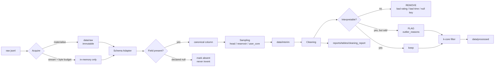

**Why suspicious rows are flagged, not deleted:** the anomaly detector in Module 11 cannot
find what the cleaner already removed. Deleting shill-like rows here would both destroy the
evidence and flatter the trust component's apparent performance.

---

## 3. Heterogeneous graph structure

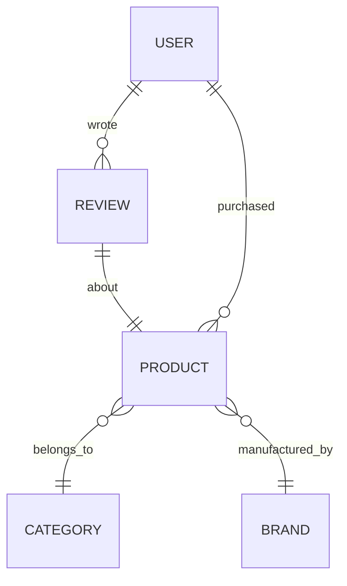

Five node types: `user`, `product`, `review`, `brand`, `category`.

**There is no `seller` node.** Amazon Reviews 2023 has no seller field, and inventing one
would put fabricated structure into the graph. `brand` is itself derived from the `store`
field, which is the Amazon storefront name — usually but not always the manufacturer. Both
approximations are disclosed wherever brand results are reported.

All edges are added in both directions (`add_reverse_edges: true`), because HGT can only
propagate information back to `user` nodes if a reverse relation exists.

---

## 4. SBERT pipeline

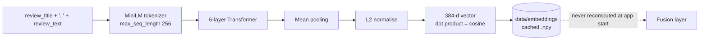

Verified on this machine: dimension **384**, `max_seq_length` **256**, unit norm.
Empty review text yields a zero vector rather than an embedding of the empty string.

---

## 5. Behavioural trust pipeline (CoLA kept as a control)

```mermaid
flowchart TD
    A[Training interactions] --> B1["shared_text<br/>share of reviews whose text other accounts also posted"]
    A --> B2["own_repeat<br/>share of reviews repeating the user's own text"]
    A --> B3["burstiness<br/>most reviews in any 24 h window / history"]
    B1 & B2 & B3 --> C["Rank-normalise each, average with equal weight"]
    C --> D["Thin history (&lt; 3 interactions) → median score"]
    D --> E["Anomaly score a_i — higher = more suspicious"]
    E --> F["trust = 1 − rank-norm(a_i), clamp [0.05, 1]"]
    F --> G[Propagate user → interaction]
    G --> H["Per-interaction weight (acts on the loss)"]

    X["CoLA on user–product projection"] -.-> Y["Control: AUC 0.295, below chance"]

    style E fill:#4a1a1a,stroke:#c99
    style F fill:#1a4a2a,stroke:#9c9
    style Y fill:#3a3a1a,stroke:#cc9
```

1. **CoLA is not the trust source.** It scores a node by how predictable its attributes are from its
   neighbourhood, and a coordinated campaign is consistent by construction, so it ranks shills as
   *more* trustworthy (ROC AUC 0.2951 on the synthetic benchmark). The behavioural detector asks
   instead whether the account behaves like a campaign account (AUC 0.9997 on the same benchmark,
   which is easy by design — see the paper's limitations).
2. **No threshold and no weight is tuned.** A fourth indicator (distance from the item's mean
   rating) was tried and removed because it pointed the wrong way on the benchmark.
3. **The floor exists for a concrete reason.** A trust of exactly 0 in a weighted loss would
   silently delete an interaction from training and change the effective dataset size.

---

## 6. Trust and recency weighting — on the loss, not on edges

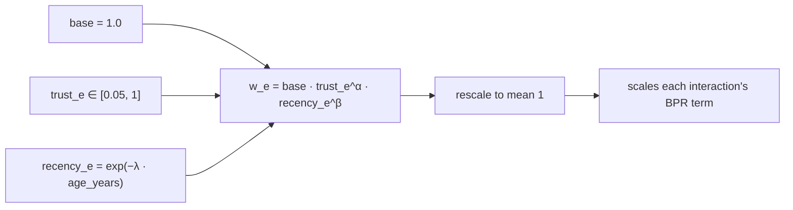

`age` is measured from `max_train_timestamp`, **never from wall-clock now**. λ is selected on the
validation split (the best value found was 2 per year).

**Why the loss and not the edge.** `HGTConv` takes only `edge_index`. An edge weight stored on the
graph is never read, so the first version of this project's trust/recency arms C, D and E were
identical to arm B, and the score differences between them were seed noise. Weighting the
objective is what actually reaches the model.

**Why validation overstates recency.** Validation is the period right after training; test lies one
period further out. A decay tuned on validation is tuned for a horizon the test does not have, so
recency looks like +43% on validation and +6% on test. The refit protocol (retrain on train +
validation for the epochs validation selected) removes the gap and is reported separately.

---

## 7. HGT architecture

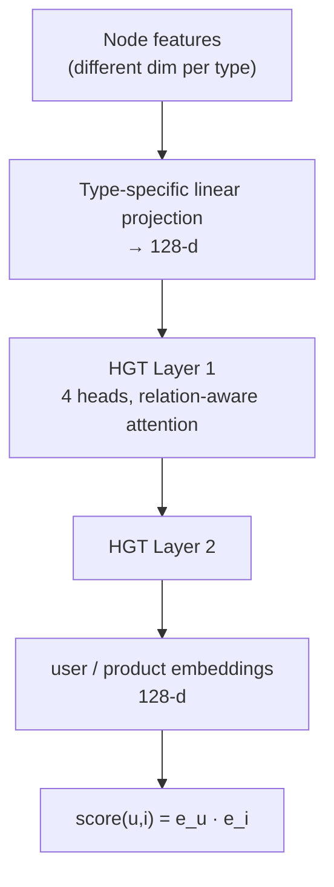

Settings chosen on validation: `hidden_channels=128`, `num_heads=4`, `num_layers=2`, `dropout=0.1`,
`lr=0.01`, edge-mask keep fraction 0.5. Verified on this machine: HGTConv forward **and backward** both
execute on the MPS backend.

### Training: edge masking and validation stopping

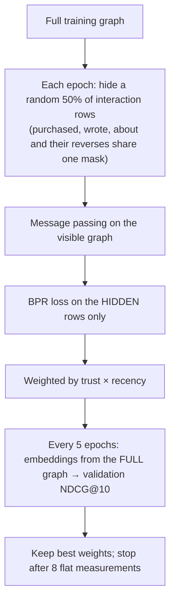

The interaction being scored is also a message-passing edge, so an unmasked HGT can read the label off
the graph. Measured: without masking NDCG@10 equals matrix factorisation's; with it, +47–59%.

---

## 8. Explainability and counterfactual pipelines

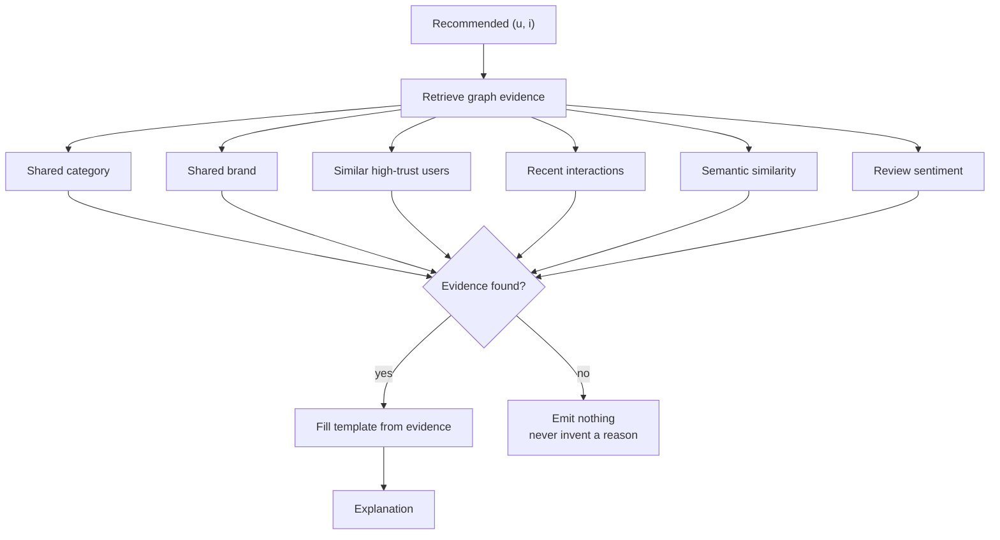

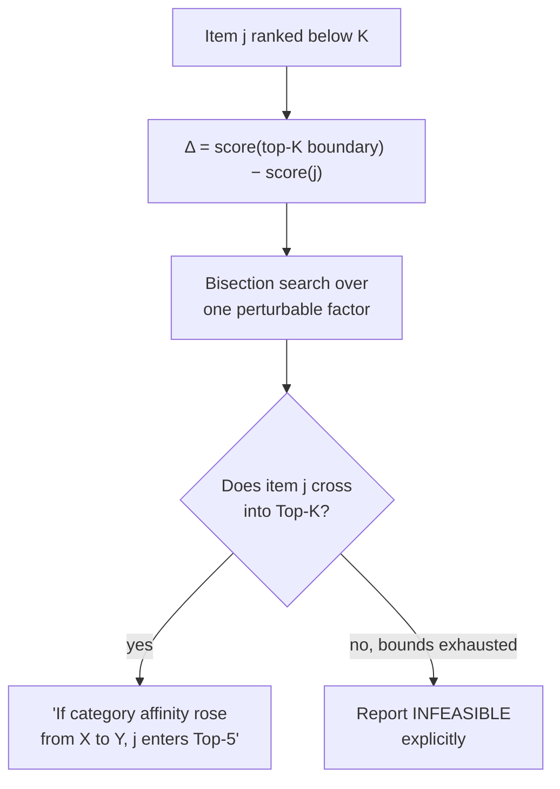

---

## 9. Deployment architecture

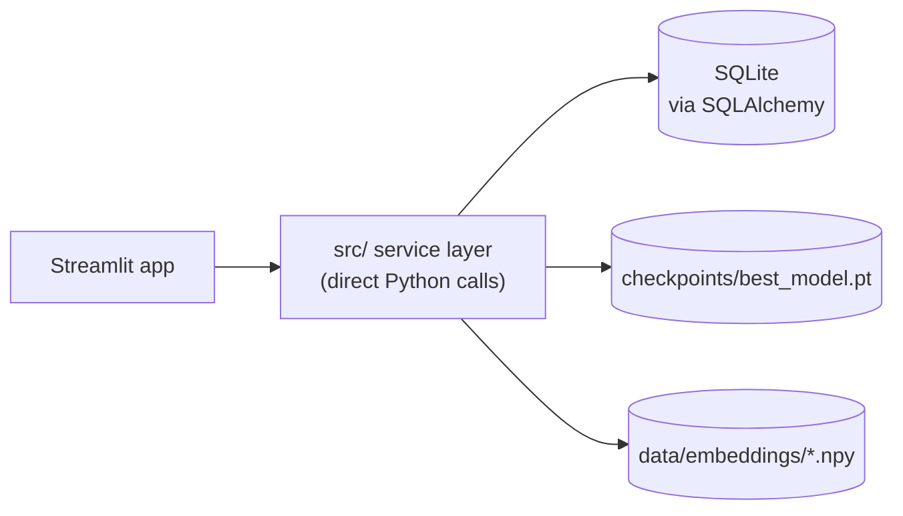

**No FastAPI layer.** Streamlit and the model run in one process on one machine, so an
internal HTTP hop would add deployment surface and serialisation cost for no capability.
The `src/` modules are written as a plain service layer, so a FastAPI façade can be added
later without touching them — but it is not added merely to make the diagram look larger.

---

## 10. Database ER diagram

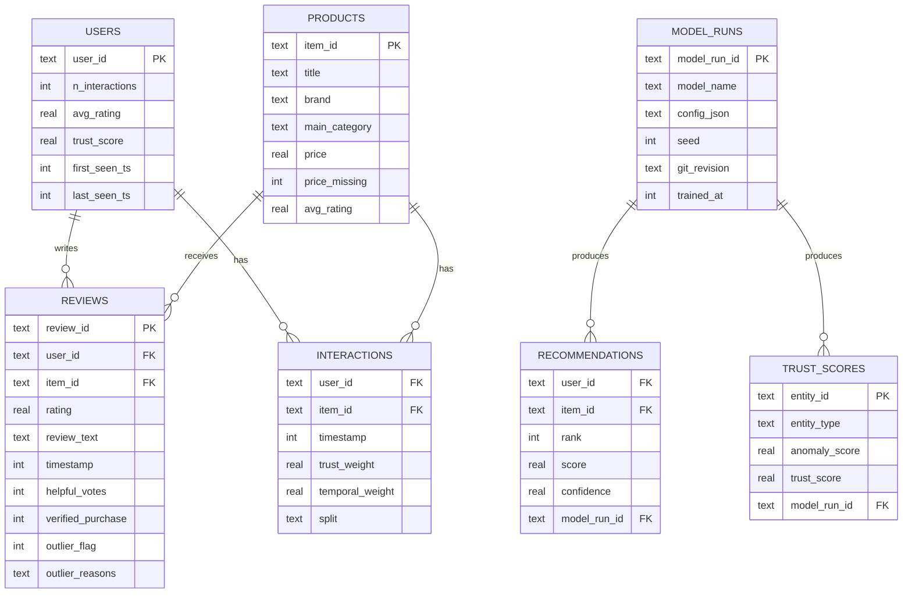

---

## 11. Data leakage controls

```mermaid
flowchart TD
    A[All interactions, sorted by time] --> B["Chronological split<br/>80 / 10 / 10"]
    B --> C[Train: t < t_val]
    B --> D[Val: t_val ≤ t < t_test]
    B --> E[Test: t ≥ t_test]
    C --> F["Training graph<br/>ONLY train edges"]
    F --> G[Fit scalers on train only]
    F --> H[Trust detectors fitted on train only]
    F --> I["Recency reference =<br/>max_train_timestamp"]
    D -.->|never| F
    E -.->|never| F
    J[Negative sampling] --> K["Exclude positives from<br/>ALL splits, not just train"]

    style E fill:#4a1a1a,stroke:#c99
```

Enforced in code and asserted in `tests/`. One caveat is disclosed rather than hidden:
**k-core filtering** selects users and items using counts over the whole timeline, including
the test period. This is standard practice in the recommender-systems literature but it is a
mild selection leakage; it is recorded in every cleaning report and can be disabled in config.
